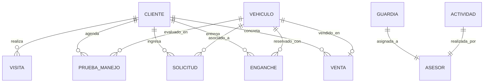

# Arquitectura y Documentación Técnica — Outlet Autocorp Mini CRM

Este documento detalla la estructura modular, los patrones de diseño, el flujo de datos reactivo y las pautas de escalabilidad para el sistema **Mini CRM de Outlet Autocorp**.

---

## 1. Principios de Diseño de Software

El sistema fue diseñado bajo estrictos principios de ingeniería de software orientados a la mantenibilidad, extensibilidad y claridad:

1. **Separación de Responsabilidades (Separation of Concerns - SoC)**:
   - **Capa de Datos (`store.js`)**: Gestiona exclusivamente el estado global, la persistencia en `localStorage`, la integridad referencial y las notificaciones de cambio mediante el patrón Observer.
   - **Capa de Utilidades (`utils.js`)**: Funciones puras e independientes de la UI para formateo de moneda (`MXN`), manipulación de fechas en español, validadores RFC/E.164 y algoritmos de filtrado temporal.
   - **Capa de Componentes (`components/`)**: Elementos visuales reutilizables e independientes del contexto de negocio (iconos vectoriales, notificaciones Toast, modales de confirmación accesibles y motor de gráficas SVG).
   - **Capa de Vistas (`views/`)**: Controladores de vista que administran el ciclo de vida, eventos del DOM y renderizado de cada sección (`Dashboard`, `Guardias`, `Clientes`, `Inventario`).
   - **Capa de Orquestación (`app.js`)**: Enrutador central y gestión de diseño responsivo.

2. **Reactividad Desacoplada (Patrón Observer / Pub-Sub)**:
   - El `Store` no conoce los detalles internos de las vistas.
   - Las vistas se suscriben mediante `store.subscribe(callback)`. Cuando ocurre una mutación (ej. venta confirmada, vehículo apartado, nuevo invitado), el almacén persiste los datos y notifica a las vistas activas para auto-actualizarse en tiempo real.

3. **Compatibilidad Universal Dual**:
   - La arquitectura soporta **módulos ES6 estándar** (`import`/`export`) para desarrollo modular en editores modernos.
   - Incluye un **empaquetado autocontenido (`app.bundle.js`)** que permite abrir y ejecutar la aplicación inmediatamente tanto desde servidores web (`http://`, `https://`) como directamente haciendo doble clic desde el Explorador de Archivos de Windows (`file:///`), sin bloqueos de políticas CORS de navegadores.

---

## 2. Diagrama de Flujo y Relación de Entidades



---

## 3. Estructura de Directorios

```
c:\Users\mktpsf\Desktop\Outlet Autocorp\
├── index.html                  # Punto de entrada para Diseño 1 (Barra Lateral Clásica)
├── README.md                   # Manual de usuario y presentación general
├── ARCHITECTURE.md             # Esta documentación de ingeniería de software
├── css\
│   └── styles.css              # Tokens de diseño, paleta, fuentes Gotham/Montserrat y efectos 3D
├── js\
│   ├── app.js                  # Enrutador principal y ciclo de vida de vistas
│   ├── app.bundle.js           # Bundle de producción compatible con file:// y http://
│   ├── store.js                # Almacén reactivo de datos, reglas de negocio y persistencia
│   ├── utils.js                # Formateo monetario MXN, fechas en español y validaciones
│   ├── components\
│   │   ├── icons.js            # Repositorio de iconos SVG optimizados
│   │   ├── toast.js            # Sistema accesible de notificaciones toast y modales confirm
│   │   ├── charts.js           # Motor de gráficos vectoriales interactivos (Ventas y Embudo)
│   │   └── modals.js           # Controlador modal centralizado (Invitados, Pruebas, Ventas)
│   └── views\
│       ├── dashboard.js        # Vista General: 6 KPIs, filtros de periodo, gráficas y eventos
│       ├── guardias.js         # Vista Guardias & Actividades: Calendario mes/semana y flip cards 3D
│       ├── clientes.js         # Vista Clientes: Tabla, detección de duplicados y Ficha 360
│       └── inventario.js       # Vista Inventario: Tarjetas/Tabla, filtros multicriterio y Ficha 360
└── diseno2\                    # DISEÑO ALTERNATIVO 2: EXECUTIVE SHOWROOM STUDIO
    ├── index.html              # Entrada a Diseño 2 con barra superior flotante
    ├── css\
    │   └── styles.css          # Estilos premium: Widescreen cards, glassmorphism y micro-glow
    └── js\
        └── app.js              # Controlador reactivo para Diseño 2
```

---

## 4. Comparativa de Diseños (Diseño 1 vs. Diseño 2)

Ambos diseños coexisten en el mismo proyecto, **comparten la misma base de datos en tiempo real (`localStorage`)** y se enlazan mediante un conmutador de 1 clic en el encabezado:

| Característica | Diseño 1: Clásico Institucional | Diseño 2: Executive Showroom Studio |
|---|---|---|
| **Punto de Entrada** | [`index.html`](file:///c:/Users/mktpsf/Desktop/Outlet%20Autocorp/index.html) | [`diseno2/index.html`](file:///c:/Users/mktpsf/Desktop/Outlet%20Autocorp/diseno2/index.html) |
| **Navegación** | Menú lateral permanente en `#251f1d` con drawer móvil | Barra superior ejecutiva (*Top Command Bar*) con dock flotante tipo pastilla |
| **Tarjetas de Autos** | Formato 4:3 con caja de precios inferior | Formato panorámico 16:9 cinematográfico con simulador financiero integrado |
| **KPIs** | Tarjetas verticales con iconos grandes | Tarjetas horizontales con medidores y porcentajes destacados |
| **Actividades** | Giro 3D estándar con panel de observaciones | Giro 3D con borde metálico y actualización táctil de estado |
| **Calendario** | Calendario mensual amplio con popover flotante | Planificador visual con badges de turno |

---

## 5. Reglas de Negocio Implementadas

1. **Diferenciación de Enganches**:
   - `estimatedDownPayment` es un cálculo financiero orientativo (generalmente el 20% del valor del auto).
   - `downPayments` almacena importes reales cobrados en caja vinculados a un recibo o SPEI.
   - **Solo los importes recibidos se suman al KPI de Enganche**.

2. **Detección de Duplicados en Clientes**:
   - Durante la captura de un prospecto, el sistema limpia los caracteres no numéricos del teléfono y normaliza el correo en minúsculas.
   - Si detecta coincidencia con un registro existente, despliega una alerta preventiva invitando a registrar una nueva visita en la ficha existente para no duplicar datos.

3. **Consistencia de Inventario y Ventas**:
   - Una unidad en estado `vendido` queda protegida contra nuevos apartados o ventas.
   - Al registrar una venta, el vehículo transita inmediatamente a `vendido`, el inventario disponible descuenta la unidad y el KPI de Ventas suma el importe final pactado.

---

## 6. Guía de Escalabilidad: Cómo Extender el Sistema

### A. Agregar una Nueva Vista al Menú
1. Crear el archivo `js/views/mi_nueva_vista.js` con una clase que implemente:
   ```javascript
   export class MiNuevaVista {
     constructor(app) { this.app = app; }
     render(container) {
       container.innerHTML = `<div class="mi-vista">...</div>`;
     }
   }
   ```
2. Registrar la vista en `js/app.js`:
   - Añadir el botón en el menú de navegación (`<button class="nav-item" data-view="mi_vista">`).
   - Instanciar el controlador en el constructor de `App`.
   - Añadir el caso en el método `navigate(viewId)`.

### B. Conectar con un Backend Remoto (REST API o Firebase / Supabase)
El archivo `js/store.js` está preparado para sustituir el almacenamiento en `localStorage` por llamadas `fetch()` asíncronas:
```javascript
// Ejemplo de migración a API remota:
async addVehicle(vehicleData) {
  const response = await fetch('/api/vehicles', {
    method: 'POST',
    headers: { 'Content-Type': 'application/json' },
    body: JSON.stringify(vehicleData)
  });
  const newVehicle = await response.json();
  this.data.vehicles.unshift(newVehicle);
  this.notify();
  return newVehicle;
}
```

---

## 7. Accesibilidad (a11y) y Estándares Web

- **Navegación por Teclado**: Todos los elementos interactivos cuentan con `tabindex="0"`, estados `:focus-visible` claramente delineados con el color institucional naranja `#ff8901`, y respuesta a teclas `Enter`, `Espacio` y `Escape` (en modales y tarjetas flip).
- **Contraste de Color**: La paleta cumple con los estándares WCAG AA en ratios de contraste sobre fondo claro `#f6f6f6` y fondo oscuro `#251f1d`.
- **Movimiento Reducido**: Se implementaron consultas `@media (prefers-reduced-motion: reduce)` para anular animaciones 3D en usuarios que lo tengan configurado en su sistema operativo.
